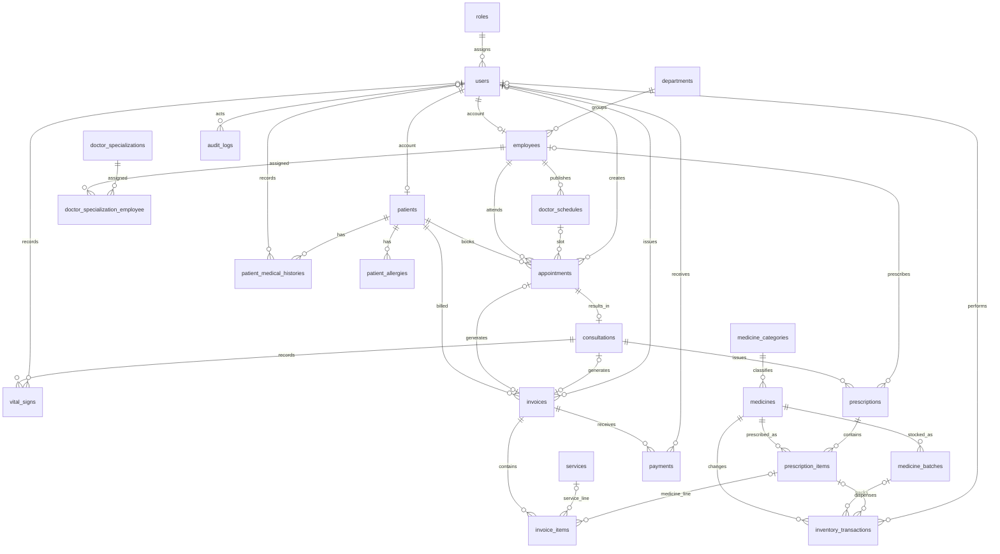

# Clinic management database schema

Database: `clinic_management_db` (MySQL, InnoDB, `utf8mb4`). Primary keys are unsigned big integers. Monetary columns use `DECIMAL(10,2)`; stock and dosage quantities use `DECIMAL(12,3)`.

## Tables

| Table | Purpose |
| --- | --- |
| `roles` | Defines a named role and unique slug for each user account role. |
| `users` | Stores staff or patient login identities, their role, and Laravel password/remember fields. Soft deleted to retain account references. |
| `departments` | Clinic departments used to group employees. |
| `employees` | Staff identity, department, contact, job, and employment status. A nullable unique user link allows staff without a login. Soft deleted. |
| `doctor_specializations` | Reusable specialty catalog. Employees can have multiple specialties and each specialty can be assigned to multiple employees. The `doctor_specialization_employee` pivot stores assignments and the primary-specialty marker. |
| `doctor_specialization_employee` | Many-to-many employee/specialty assignment pivot with a composite primary key and primary-specialty flag. |
| `patients` | Patient demographics, clinic number, optional linked user, and emergency contact. Soft deleted. |
| `patient_allergies` | Patient allergen, reaction, severity, and notes. |
| `patient_medical_histories` | Patient conditions with optional diagnosis/resolution dates and the user who recorded them. |
| `doctor_schedules` | Recurring weekday availability, time range, appointment slot length, and optional validity dates for an employee. |
| `appointments` | A patient booking with its doctor, optional schedule, date/time, status, and creator. A unique doctor/time pair prevents duplicate starts. |
| `consultations` | Clinical notes and diagnosis for an appointment; appointment is unique, so each appointment has at most one consultation. |
| `vital_signs` | Timestamped measurements recorded during a consultation. Multiple readings are allowed. |
| `prescriptions` | Prescription header issued during a consultation and optional prescribing employee. |
| `prescription_items` | Prescribed medicine, dose, frequency, duration, quantity, and instructions. |
| `services` | Billable clinic service catalog with current price and duration. Soft deleted while preserving invoice snapshots. |
| `invoices` | Patient charge header, optionally tied one-to-one to an appointment and consultation, with totals and status. |
| `invoice_items` | Invoice line snapshots with a description and unit price, optionally linked to a service or prescription item. |
| `payments` | Individual receipts and payment attempts against an invoice, including method and reference. |
| `medicine_categories` | Unique medicine categories. Soft deleted while preserving medicine references. |
| `medicines` | Medicine catalog, SKU, unit, current prices, and reorder threshold. Stock totals are derived from batches/transactions rather than duplicated here. Soft deleted. |
| `medicine_batches` | Received stock batch, expiry, received and remaining quantities, and batch cost. |
| `inventory_transactions` | Append-only stock changes tied to a medicine and optionally a batch, prescription item, and acting user. Positive quantities add stock; negative quantities remove it. |
| `audit_logs` | Append-only user and polymorphic record audit events with JSON before/after values and request metadata. |

## Relationship diagram

The `audit_logs.auditable_type` and `auditable_id` pair is a polymorphic reference, so its target table is intentionally not a database foreign key. Historical clinical and financial records are retained by restricting destructive deletes or using soft deletes on master/person records.
